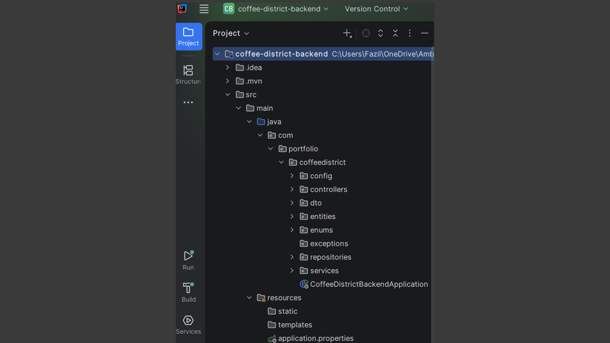
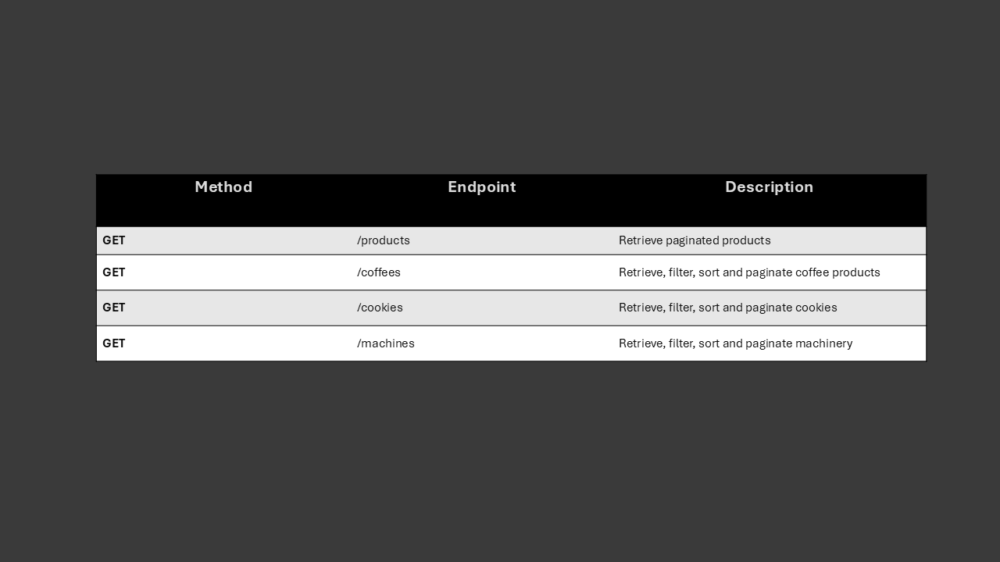
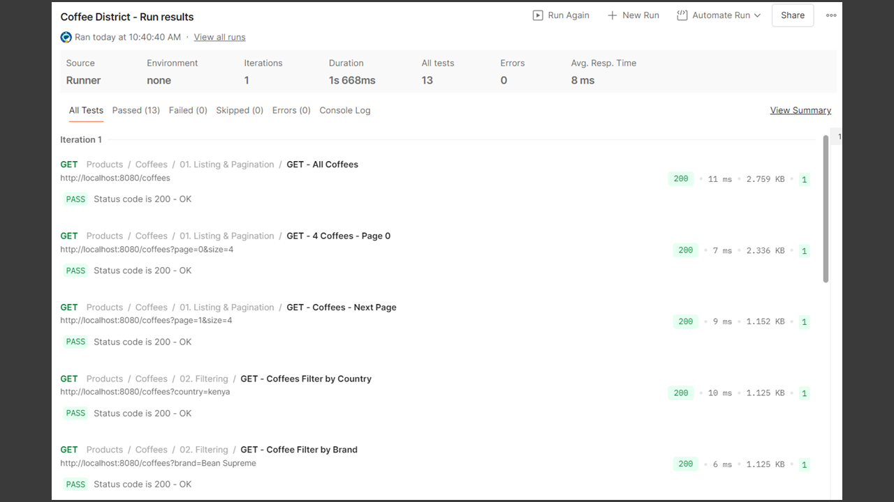
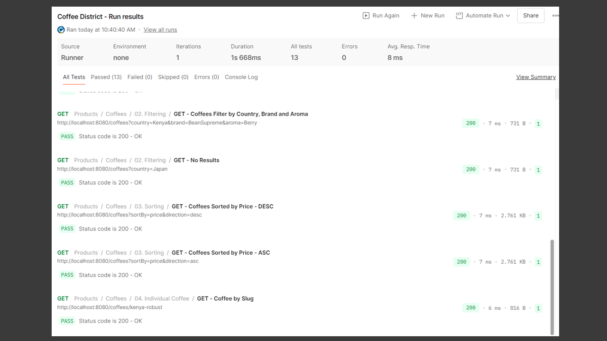
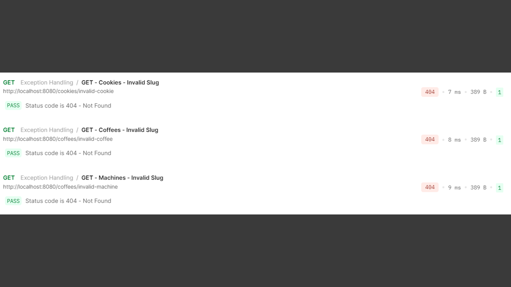

# coffee-district-backend
Coffee District is a full-stack e-commerce application for exploring coffee, cookies and brewing equipment, allowing users to browse products and manage a shopping cart.  

This independent portfolio project was developed as part of my practical learning journey in full-stack development. 
The repository contains the backend application, developed with Java and Spring Boot. It provides REST APIs for product retrieval and user authentication, with data persistence handled through Spring Data JPA and MySQL.  
 
The project follows a layered architecture, separating HTTP request handling, business logic, data access and entity modelling.  
Additional development materials, testing resources, design assets and documentation can be presented and discussed during the interview process.  
 
 
🔗 Frontend repository: https://github.com/fazilak-a/coffee-district-frontend  

 

## Technologies  
- Java  
- Spring Boot  
- Spring Data JPA 
- Hibernate 
- Spring Security 
- MySQL 
- Maven 
- BCrypt password hashing 
- REST APIs 
- Postman API testing 
 

## Main Features
 

**Product Catalogue** 
•	Retrieve products through paginated API endpoints 
•	Retrieve products by category 
•	Retrieve individual products using their slugs 
•	Filter coffee products by country, brand and aroma 
•	Filter cookie products by brand and allergens 
•	Filter machinery products by country, brand and color 
•	Sort and paginate product results 

 

**User Authentication** 
•	User registration with password hashing using BCrypt 
•	Login using email and password 
•	Session-based authentication 
•	Retrieve the authenticated user's profile 
•	Role-based authorization structure 

 

**Data Persistence** 
•	Relational database integration using MySQL 
•	Entity mapping and persistence through JPA and Hibernate 
•	Shared product attributes managed through entity inheritance using JPA 

 

## Project Structure
The backend follows a layered architecture, with a clear separation of responsibilities across controllers, services, repositories, entities and configuration components.
The structure below highlights the main packages and classes included in this public repository.  
 

 
 

## Architecture 
The application follows a layered architecture, with controllers handling HTTP requests and delegating business logic to services, which interact with repositories for data access.
 

- **Controllers:** Handle HTTP requests and expose REST endpoints 
- **Services:** Contain business logic 
- **Repositories:** Provide data access through Spring Data JPA 
- **Entities:** Model application data, including Product, Coffee, Cookie and Machine 
- **DTOs:** Define the data transferred between application layers and the frontend 
- **Config:** Contains application configuration, security and authentication components 
- **Enums:** Define application-specific values, including categories and user roles 

 

## API Endpoints Example

 
 

**Example: Filtering and Pagination** 
The following endpoint demonstrates the combination of multiple filters, pagination and sorting in a single request. 
 

GET /coffees?country=brazil&brand= amazoniaroastery &aroma=chocolate&page=0&size=12&sort=price  

 

## API Testing
API endpoints were tested both manually and through automated Postman tests, covering successful requests, filtering, pagination, sorting and invalid product lookup 
 
The following screenshots demonstrate selected API requests and their corresponding responses.  
 

**Product Retrieval and Pagination**    

 
 
**Product Filtering and Sorting**   

 
 

**Invalid Product Lookup**   

 

## Running the Application
1.	Clone the repository
2.	Create a MySQL database named coffeedistrict.
3.	Configure the MySQL database connection in application.properties, including the database URL, username and password.
4.	Run the Spring Boot application
5.	Access the API at http://localhost:8080

 

## Project Status
**In progress:** enhanced exception handling and meaningful HTTP error responses  
**Future improvements:** Admin product management for CRUD operations  
**Scope limitation:**  No payment gateway or online payment processing is included  
